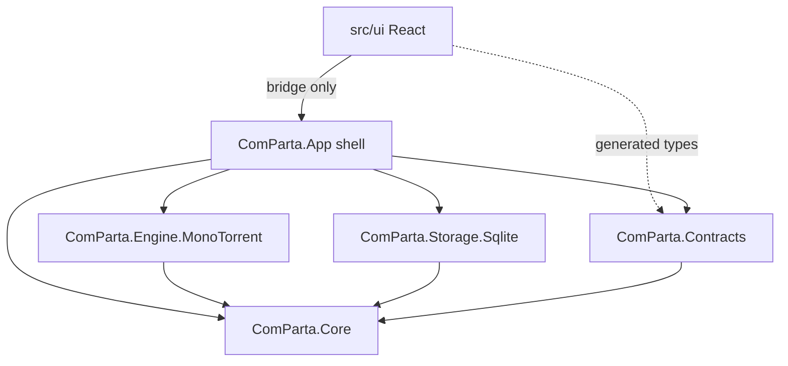
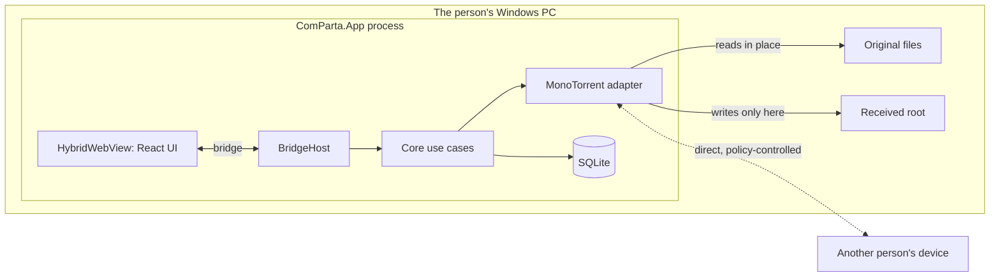
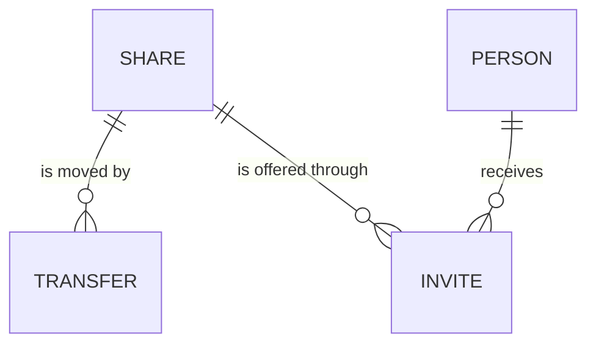

# Architecture Spine — ComParta

## Design Paradigm

Hexagonal (ports and adapters). The core holds the product's rules and knows nothing about the screen, the torrent engine, the database or the operating system. Everything else plugs into ports the core defines.

| Layer | Namespace / directory | Holds |
| --- | --- | --- |
| Core | `ComParta.Core` | Domain (`Share`, `Transfer`, `Person`, `Invite`), use cases, ports |
| Contracts | `ComParta.Contracts` | Bridge command names, event names, DTOs, error codes, and `BridgeRouter`, which runs a command against the core without any shell |
| Driven adapters | `ComParta.Engine.MonoTorrent`, `ComParta.Storage.Sqlite` | Implementations of core ports |
| Shell (driving adapter) | `ComParta.App` | .NET MAUI host, `BridgeHost`, platform ports (file picker, content opener, paths) |
| UI | `src/ui` | React app; renders state, sends commands |

## Invariants & Rules



An arrow means "may depend on". `ComParta.Core` depends on no other project and on no MAUI, MonoTorrent, SQLite or web-view package. Only `ComParta.App` wires adapters to ports.

### AD-1 — C# core, React UI, MAUI shell [ADOPTED]

- **Binds:** all
- **Prevents:** a codebase the maintainer cannot read, and separate cores per platform.
- **Rule:** All product logic is C# in `ComParta.Core`. All screens are React in `src/ui`. The shell is .NET MAUI with one `HybridWebView`; the same core and UI must serve Windows now and Android later. `[ASSUMPTION]` MAUI on Windows is adequate for the MVP; a WPF + WebView2 shell is the fallback and must stay a drop-in because of AD-2 and AD-3.

### AD-2 — The torrent engine lives behind one port

- **Binds:** engine, core, storage, contracts
- **Prevents:** engine lock-in; engine types spreading into storage, contracts and UI.
- **Rule:** Core talks to the engine only through `ITransferEngine`. MonoTorrent types, info-hashes, magnet links and `.torrent` data never appear outside `ComParta.Engine.MonoTorrent`. The adapter maps `ShareId` to its own engine identifiers and keeps that mapping in its own data folder.

### AD-3 — One bridge between UI and core

- **Binds:** UI, shell, contracts
- **Prevents:** each story inventing its own channel (local HTTP server, ad hoc messages, direct JS file access).
- **Rule:** The UI reaches the app only through `src/ui/src/bridge`. Commands go UI → core as `InvokeDotNet` calls on the single `BridgeHost` class. Events go core → UI as one raw-message envelope. No local web server, no `fetch` to anything, no other interop. Command names, event names and DTOs are declared once in `ComParta.Contracts`; the TypeScript types are generated from it and never written by hand.

### AD-4 — Core owns state; the UI is a projection

- **Binds:** UI, core
- **Prevents:** two sources of truth; UI state drifting from what is really shared.
- **Rule:** The UI keeps no product state of its own beyond view state (open dialog, selected row). It loads a snapshot with a query command and updates from change events. Every change is a command; the UI never edits its copy optimistically without a command.

### AD-5 — Plain-language vocabulary

- **Binds:** UI, contracts, core
- **Prevents:** torrent jargon leaking to users through names that started in code.
- **Rule:** The words seed, peer, leech, swarm, tracker, magnet, torrent, hash and DHT are allowed only inside `ComParta.Engine.MonoTorrent`. Everywhere else the terms are `Share` (something you offer), `Transfer` (bytes moving), `Person`, `Invite`.

### AD-6 — Sharing never touches the original; receiving has one home

- **Binds:** core, engine, shell, UI
- **Prevents:** stories disagreeing on what "remove" means, causing data loss; received files scattered across the disk.
- **Rule:** Adding a share references the file where it is; it is never copied, moved or modified. Removing a share stops offering it and deletes only ComParta's own records; the original file is never deleted or changed. Received content is written only under the single Received root supplied by `IAppPaths`, and every path taken from received metadata passes through one sanitising function in core before use.

### AD-7 — File paths enter only through the native picker

- **Binds:** UI, shell, core
- **Prevents:** path handling split between JavaScript and C#; UI code passing arbitrary paths to the core.
- **Rule:** No bridge command accepts a filesystem path from the UI. Choosing a file is a command that makes the shell open the native picker behind `IFilePicker`; the core receives the result. The UI is given display names and sizes, never a path it must send back.

### AD-8 — Network behaviour is set in one place; devices meet only through an invite

- **Binds:** engine, core
- **Prevents:** a story switching on wider discovery and exposing family files; inconsistent network settings per share.
- **Rule:** All discovery, encryption and port settings come from one `SharingPolicy` object in core, applied only by the engine adapter. The policy (decided 2026-10-08) allows three ways for two devices to meet, all keyed by the invite: the sender's own network address carried inside the invite, local-network discovery, and the public BitTorrent lookup network (DHT). Peer exchange and trackers stay off, addresses of servers found in a pasted invite are dropped, and connections are encrypted. No other code sets engine network options.
- **Rule (decided 2026-10-12):** A share is reachable from the whole internet, not only the local network. The sender's address in the invite includes the public address, and the app asks the router to open the listening port (UPnP / NAT-PMP). The public address is learned from the router or the lookup network, never from a third-party "what is my IP" service (AD-9). The engine reports whether the share can be reached from outside; the UI words it (AD-11).
- **Accepted trade-off:** the content's fingerprint is announced on the public lookup network, so a share is unlisted, not secret: only someone holding the invite can ask for it, but the fingerprint is not hidden from that network. A stronger model (per-person keys) stays in Deferred.
- **Accepted trade-off (2026-10-12), for family and friends:** the invite is a bearer key, so anyone holding it can download, it never expires, and removing the share is the only revocation. The sender's public address is visible to anyone who asks for the fingerprint or connects. The encryption hides traffic from casual inspection but is not confidentiality. Uploads are not limited.

### AD-9 — No hosted services, no accounts, no telemetry

- **Binds:** all
- **Prevents:** a cloud dependency arriving through a convenience feature.
- **Rule:** No code calls a service operated by the ComParta project or a third-party hosted API, and nothing is collected or sent. There is no sign-in. When identity is needed it is a key pair generated and kept on the device.

### AD-10 — Each kind of data has one owner

- **Binds:** storage, engine, core
- **Prevents:** two components writing the same record; engine cache mixed with product data.
- **Rule:** Product data lives in one SQLite database written only by `ComParta.Storage.Sqlite` through core repository ports. Engine cache and resume data live in a sibling folder written only by the engine adapter. Both locations come from `IAppPaths`. `ShareId` is a GUID generated by core.

### AD-11 — Errors are codes; words belong to the UI

- **Binds:** core, contracts, UI
- **Prevents:** English prose from C# appearing in a translated screen; UI stories matching on message text.
- **Rule:** Every command returns `{ ok, value }` or `{ ok: false, error: { code } }`. Codes are stable strings declared in `ComParta.Contracts`. All user-facing text lives in the UI's translation catalog, keyed by code; core and adapters return no display text.

### AD-12 — Every side runs without the other

- **Binds:** UI, core, engine
- **Prevents:** stories that can only be built or checked with the whole app running.
- **Rule:** `src/ui` runs in a normal browser against a fake bridge that implements the full contract. `ComParta.Core` is tested against in-memory fakes of every port. A story that adds a command adds it to the contract, the fake bridge and the core tests in the same change.

## Consistency Conventions

| Concern | Convention |
| --- | --- |
| Naming | C# projects and namespaces `ComParta.<Area>`; ports `I<Noun>`; DTOs end in `Dto`. Bridge commands `area.verbNoun` (`shares.add`, `shares.remove`, `shares.list`); events `area.changed`. React components PascalCase, one per file. |
| Data & formats | Ids are GUID strings. Times are ISO 8601 UTC. Sizes are bytes as integers; the UI formats them. JSON across the bridge is camelCase. Event envelope: `{ event, payload }`. |
| State & cross-cutting | Mutations only by commands (AD-4). Logs are local files under `IAppPaths`; never log file contents. Settings are stored in the product database. UI text only through the translation catalog; English first, Brazilian Portuguese planned. |
| Testing | xUnit for C#, Vitest for UI. Core tests use fakes, not MonoTorrent. Engine adapter has its own integration tests. |

## Stack

| Name | Version |
| --- | --- |
| .NET (LTS) | 10.0.x |
| .NET MAUI (`HybridWebView`) | 10.0.x |
| MonoTorrent | 3.0.2 |
| Microsoft.Data.Sqlite | 10.0.x |
| React | 19.2.x |
| Vite | 8.1.x |
| TypeScript | version shipped by the Vite 8.1 React template |
| xUnit / Vitest | latest stable at scaffold time |

Exact patch numbers are pinned by the scaffold story.

## Structural Seed





`SHARE` and `TRANSFER` exist in the first release. An invite is plain text produced by the engine adapter and is not stored as an entity yet; `PERSON` is named so later epics use the same word.

```text
ComParta/
  src/
    ComParta.Core/               # domain, use cases, ports
    ComParta.Contracts/          # bridge commands, events, DTOs, error codes
    ComParta.Engine.MonoTorrent/ # ITransferEngine implementation
    ComParta.Storage.Sqlite/     # repository implementations
    ComParta.App/                # MAUI shell, BridgeHost, platform ports
    ui/                          # React + Vite; build output -> ComParta.App/Resources/Raw/wwwroot
  tests/
    ComParta.Core.Tests/         # core, bridge router and architecture guards
    ComParta.Storage.Sqlite.Tests/
    ComParta.Engine.MonoTorrent.Tests/
  tools/
    ComParta.Contracts.TypeGen/  # writes src/ui/src/bridge/contract.generated.ts
  Planning/
```

Operational envelope: the product is an installed desktop app with no servers and no environments beyond the developer's machine and the user's device. Continuous integration builds and tests on a Windows runner.

## Deferred

| Item | Why it can wait | Revisit when |
| --- | --- | --- |
| Stronger privacy model: per-person keys so that only chosen people can download, and no fingerprint on the public lookup network | The first release uses the invite-as-secret model in AD-8. | Before the app is offered to people outside the maintainer's circle. |
| Connecting when a router has no inbound path (carrier-grade NAT, strict routers): at least one of the two devices must accept incoming connections, and MonoTorrent has no uTP hole punching. The public address in the invite, automatic port mapping and the reachability status (AD-8) cover the common case | Most home routers can map a port, and AD-2 keeps an engine swap cheap. | After the first real two-household transfers. |
| Hardening considered and not decided: an upload rate limit and connection cap, invites that expire, an option to turn the public lookup network off | The AD-8 trade-off is accepted for family and friends. | Before the app is offered outside the maintainer's circle. |
| Operating-system sandbox on Windows, and scanning or marking of received files | AD-6 already contains received content at app level. | Before the first epic that receives a file. |
| Open source license | Does not affect code structure; MonoTorrent's MIT license fits MIT, Apache-2.0 and AGPL-3.0. | Before the repository is made public. |
| Packaging, code signing and updates | Not needed until other people install it. An update check is a network call and must be reconciled with AD-9. | Before the first public release. |
| Android shell, background sharing on phones | MVP is Windows only; AD-1 keeps the path open. | When the mobile epic is planned. |
| Type generation tool for `ComParta.Contracts` → TypeScript | Any tool satisfies AD-3. | In the bridge scaffold story. |
| Accessibility and visual design system | UX concern, not a consistency invariant here. | When `bmad-ux` runs or the first screen story is refined. |
