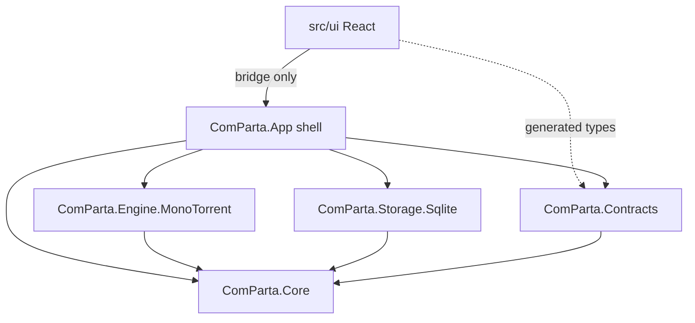
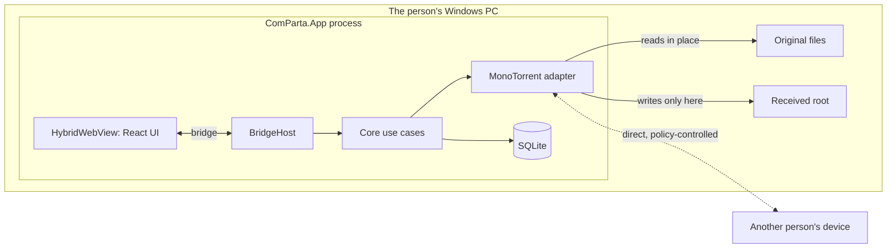
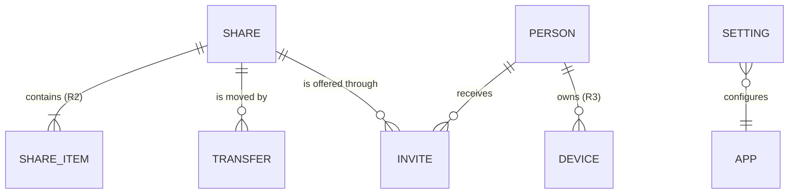

# Architecture Spine — ComParta

## Design Paradigm

Hexagonal (ports and adapters). The core holds the product's rules and knows nothing about the screen, the torrent engine, the database or the operating system. Everything else plugs into ports the core defines.

| Layer | Namespace / directory | Holds |
| --- | --- | --- |
| Core | `ComParta.Core` | Domain (`Share`, `Transfer`, `Person`, `Invite`), use cases, ports |
| Contracts | `ComParta.Contracts` | Bridge command names, event names, DTOs, error codes, and `BridgeRouter`, which runs a command against the core without any shell |
| Driven adapters | `ComParta.Engine.MonoTorrent`, `ComParta.Storage.Sqlite` | Implementations of core ports |
| Shell (driving adapter) | `ComParta.App` | .NET MAUI host, `BridgeHost`, platform ports (file picker, content opener, paths) |
| UI | `src/ui` | React app; renders state, sends commands |

## Invariants & Rules



An arrow means "may depend on". `ComParta.Core` depends on no other project and on no MAUI, MonoTorrent, SQLite or web-view package. Only `ComParta.App` wires adapters to ports.

### AD-1 — C# core, React UI, MAUI shell [ADOPTED]

- **Binds:** all
- **Prevents:** a codebase the maintainer cannot read, and separate cores per platform.
- **Rule:** All product logic is C# in `ComParta.Core`. All screens are React in `src/ui`. The shell is .NET MAUI with one `HybridWebView`; the same core and UI must serve Windows now and Android later. `[ASSUMPTION]` MAUI on Windows is adequate for the MVP; a WPF + WebView2 shell is the fallback and must stay a drop-in because of AD-2 and AD-3.

### AD-2 — The torrent engine lives behind one port

- **Binds:** engine, core, storage, contracts
- **Prevents:** engine lock-in; engine types spreading into storage, contracts and UI.
- **Rule:** Core talks to the engine only through `ITransferEngine`. MonoTorrent types, info-hashes, magnet links and `.torrent` data never appear outside `ComParta.Engine.MonoTorrent`. The adapter maps `ShareId` to its own engine identifiers and keeps that mapping in its own data folder.

### AD-3 — One bridge between UI and core

- **Binds:** UI, shell, contracts
- **Prevents:** each story inventing its own channel (local HTTP server, ad hoc messages, direct JS file access).
- **Rule:** The UI reaches the app only through `src/ui/src/bridge`. Commands go UI → core as `InvokeDotNet` calls on the single `BridgeHost` class. Events go core → UI as one raw-message envelope. No local web server, no `fetch` to anything, no other interop. Command names, event names and DTOs are declared once in `ComParta.Contracts`; the TypeScript types are generated from it and never written by hand.

### AD-4 — Core owns state; the UI is a projection

- **Binds:** UI, core
- **Prevents:** two sources of truth; UI state drifting from what is really shared.
- **Rule:** The UI keeps no product state of its own beyond view state (open dialog, selected row). It loads a snapshot with a query command and updates from change events. Every change is a command; the UI never edits its copy optimistically without a command.

### AD-5 — Plain-language vocabulary

- **Binds:** UI, contracts, core
- **Prevents:** torrent jargon leaking to users through names that started in code.
- **Rule:** The words seed, peer, leech, swarm, tracker, magnet, torrent, hash and DHT are allowed only inside `ComParta.Engine.MonoTorrent`. Everywhere else the terms are `Share` (something you offer), `Transfer` (bytes moving), `Person`, `Invite`.

### AD-6 — Sharing never touches the original; receiving has one home

- **Binds:** core, engine, shell, UI
- **Prevents:** stories disagreeing on what "remove" means, causing data loss; received files scattered across the disk.
- **Rule:** Adding a share references the file where it is; it is never copied, moved or modified. Removing a share stops offering it and deletes only ComParta's own records; the original file is never deleted or changed. Received content is written only under the single Received root supplied by `IAppPaths`, and every path taken from received metadata passes through one sanitising function in core before use.
- **Amended 2026-10-22 (epic 12 story 2):** the person may choose another Received root in Settings, through the native folder picker (AD-7). `IAppPaths.ReceivedRoot` is then the usual root, and core's `ReceivedFolder` holds the choice. Each transfer records the root it started in and is written only under that one, unfinished parts included; a new choice applies to new transfers only. The sanitising function and the containment check apply to every root alike, and a root inside ComParta's own data folders is refused.

### AD-7 — File paths enter only through the native picker

- **Binds:** UI, shell, core
- **Prevents:** path handling split between JavaScript and C#; UI code passing arbitrary paths to the core.
- **Rule:** No bridge command accepts a filesystem path from the UI. Choosing a file is a command that makes the shell open the native picker behind `IFilePicker`; the core receives the result. The UI is given display names and sizes, never a path it must send back.
- **Amended 2026-10-10:** three more native entry points count as "the picker": files dropped on the window, caught by the shell's native drop target (not the web view's); items handed over by the operating system's share menu on Android; and a folder or several files picked at once (AD-19). All three go through `IFilePicker`'s sibling port `IIncomingItems`, which raises an event the core turns into shares. The UI still never sends a path, and on Android an item is a content reference, not a path (AD-20).

### AD-8 — Network behaviour is set in one place; devices meet only through an invite

- **Binds:** engine, core
- **Prevents:** a story switching on wider discovery and exposing family files; inconsistent network settings per share.
- **Rule:** All discovery, encryption and port settings come from one `SharingPolicy` object in core, applied only by the engine adapter. The policy (decided 2026-10-08) allows three ways for two devices to meet, all keyed by the invite: the sender's own network address carried inside the invite, local-network discovery, and the public BitTorrent lookup network (DHT). Peer exchange and trackers stay off, addresses of servers found in a pasted invite are dropped, and connections are encrypted. No other code sets engine network options.
- **Amended 2026-10-10 (CAP-25):** a *download link* or *download file* the person brings from elsewhere is public content, not an invite. For those only, and only when `SharingPolicy.AllowServersInDownloadLinks` is on, the servers named in the link or file are kept and exchanging addresses with other devices is allowed for that transfer. Invites made by ComParta keep the closed rules above. The engine adapter decides which is which; core never sees the difference.
- **Rule (decided 2026-10-12):** A share is reachable from the whole internet, not only the local network. How reachability is improved and explained to the person is AD-15.
- **Amended 2026-10-13 (CAP-29):** trackers stay off unless the person names public servers in Settings (http, https or udp, at most 20). Every shared file then announces to them, files already shared included, and the link carries them as `tr=`. They help others find this computer, not reach it.
- **Amended 2026-10-13 (CAP-28, AD-23):** when a helper is set, every shared file is also handed to it and announced to its public server, and the link names the helper first.
- **Accepted trade-off:** the content's fingerprint is announced on the public lookup network, so a share is unlisted, not secret: only someone holding the invite can ask for it, but the fingerprint is not hidden from that network. A stronger model (per-person keys) stays in Deferred.
- **Accepted trade-off (2026-10-12), for family and friends:** the invite is a bearer key, so anyone holding it can download, it never expires, and removing the share is the only revocation. The sender's public address is visible to anyone who asks for the fingerprint or connects. The encryption hides traffic from casual inspection but is not confidentiality. Uploads are not limited.

### AD-9 — No hosted services, no accounts, no telemetry

- **Binds:** all
- **Prevents:** a cloud dependency arriving through a convenience feature.
- **Rule:** No code calls a service operated by the ComParta project or a third-party hosted API, and nothing is collected or sent. There is no sign-in. When identity is needed it is a key pair generated and kept on the device.
- **Amended 2026-10-13 (the maintainer's goal: any torrent app, anywhere, no router setup):** one exception, the helper (AD-23). It is open source, runs on a computer the project or the family chooses, and is named in Settings, where the person can change it or turn it off. It receives only the files the person shares and their descriptions, never usage data, and needs no account. The public servers the person names (AD-8) are not a service ComParta calls on its own.

### AD-10 — Each kind of data has one owner

- **Binds:** storage, engine, core
- **Prevents:** two components writing the same record; engine cache mixed with product data.
- **Rule:** Product data lives in one SQLite database written only by `ComParta.Storage.Sqlite` through core repository ports. Engine cache and resume data live in a sibling folder written only by the engine adapter. Both locations come from `IAppPaths`. `ShareId` is a GUID generated by core.

### AD-11 — Errors are codes; words belong to the UI

- **Binds:** core, contracts, UI
- **Prevents:** English prose from C# appearing in a translated screen; UI stories matching on message text.
- **Rule:** Every command returns `{ ok, value }` or `{ ok: false, error: { code } }`. Codes are stable strings declared in `ComParta.Contracts`. All user-facing text lives in the UI's translation catalog, keyed by code; core and adapters return no display text.

### AD-12 — Every side runs without the other

- **Binds:** UI, core, engine
- **Prevents:** stories that can only be built or checked with the whole app running.
- **Rule:** `src/ui` runs in a normal browser against a fake bridge that implements the full contract. `ComParta.Core` is tested against in-memory fakes of every port. A story that adds a command adds it to the contract, the fake bridge and the core tests in the same change.

### AD-21 — Downloads from public links share the receive path

- **Binds:** core, engine, contracts, UI, shell
- **Prevents:** a second, unsafe download path; torrent vocabulary spreading into core and UI because the feature resembles a classic client.
- **Rule:** A download from a public link or file is a `Transfer` like any other: same use cases, same Received root, same sanitising and containment (AD-6, AD-13), same states plus `paused`. Core passes link text or the bytes of a download file (read through `IFileSystem` after the native picker, AD-7) to the engine as opaque data; only the engine adapter parses them (AD-2). The UI calls them "download link" and "download file"; the extension and the classic words stay out of the catalog (AD-5). Advanced controls live behind one "More options" panel per transfer and are added as commands one at a time.

### AD-22 — Speeds come from the engine; stopping everything is a core decision the engine applies

- **Binds:** engine, core, contracts, UI
- **Prevents:** the UI adding up speeds itself from stale lists; a global stop that changes or forgets each transfer's own pause; torrent vocabulary in a details window.
- **Rule:** The engine reports activity (`EngineActivity`: total receiving and sending speed, and per share and per transfer the speeds, the number of other computers connected and the bytes moved since start) through `ITransferEngine`. Core's `ActivityUseCases` owns two flags, sending stopped and receiving stopped, stores them in the settings store (AD-10), and tells the engine with one call; the engine pauses every offer or every transfer while its flag is on, and a transfer's own pause survives a global stop and continue. Totals reach the UI as one `activity.changed` event at most once a second; a details window asks for one item's details while it is open. The UI shows a globally stopped item as "Stopped" without changing its stored state. Added 2026-10-12 for CAP-26 and CAP-27.

### AD-23 — A helper that every torrent app can use makes any share reachable

- **Binds:** engine, core, contracts, UI, and the new `ComParta.Helper` program
- **Prevents:** a relay only ComParta understands (stock apps such as qBittorrent or µTorrent could not use it); shares that work only when someone opens a router port; a helper that quietly becomes a cloud store.
- **Rule:** The helper is an ordinary BitTorrent peer with a public server (tracker), built on the same engine as the app, on a computer everyone can reach (the free Oracle Cloud machine, or a PC with one forwarded port). A sharing ComParta that has a helper set connects out to it, hands it the share's description over HTTPS with the helper key, and announces to its server; the helper fetches the bytes over that outgoing connection and serves them to anyone holding the link. The link (AD-16) names the helper's server (`tr=`) and address (`x.pe=`) first, so every torrent app on any device finds it. The helper keeps a full copy only while the share exists, within a set space, dropping the oldest first; stopping a share removes it. Only installs holding the key can add files. The engine adapter is the only code that talks to the helper; core sees a setting and a reachability fact.
- **Accepted trade-off (2026-10-13), for the family pilot:** the helper holds a copy of what it passes along and whoever runs it could read it; peer connections stay encrypted. The person is told in plain words that a copy passes through their helper computer. Who runs a helper for people outside the maintainer's family is decision D-6.

### AD-24 — Friends are device keys; core owns who is a friend and what is accepted

- **Binds:** core, storage, engine, contracts, UI
- **Prevents:** accounts or a server that knows who is friends with whom; a file from a stranger written to disk before anyone decided to accept it; each screen deciding on its own who may send.
- **Rule:** Each device has a key pair kept on the device (AD-9). Two devices become friends by exchanging public keys: an invite from ComParta carries the sender's key, and accepting an invite from someone new asks to add them as a friend first; "Add a friend" carries the key without a file. Core owns the friend list (storage) and the known-sources rule: `SharingPolicy.AcceptFromUnknown`, off on a new install, set only from the first Settings screen. Core decides, before any receive starts, whether an invite or a request to connect comes from a friend; the engine adapter authenticates devices by key and refuses unknown ones when the rule says so, before writing a byte. "What you share with me" and "new share for you" messages travel only between friends' devices. Sharing out to the open internet (AD-23) is not governed by this rule. The spike in epic 13 settles the wire details and may revise AD-8.
- **Added 2026-10-20** (the maintainer's ask, roadmap P-19). Decided 2026-10-20 (D-7): download links and download files from websites count as unknown sources too.

### AD-25 — A shared folder is a signed list; each file in it is its own transfer

- **Binds:** core, storage, engine, contracts, UI
- **Prevents:** re-sending a whole folder when one file changes; a folder that copies or moves the person's originals; friends seeing a folder someone else forged.
- **Rule:** A folder in ComParta is kept by core as a list of items (name, relative place, size, content fingerprint), not as files on disk; the originals stay where they are (AD-6). Sharing a folder with friends makes each file its own transfer and sends the friends a version of the list signed by the owner's device key. A friend's device keeps the newest valid version it has seen and offers the files in "Shared with me"; a newer version arrives whenever both devices are on, or from the helper (AD-23) when the owner cannot be reached, and the helper serves a folder only to the owner's friends. Received folder files land under the Received root in a folder of the same name. AD-19 (a share is a set of items) still describes one transfer; a folder is a list of such shares.
- **Added 2026-10-20** (P-19). The spike in epic 17 confirms the format and how versions travel.

### AD-26 — Files are shown and played by the web view, from a stream core checks

- **Binds:** core, contracts, shell, UI
- **Prevents:** the UI naming a file path (AD-7); a media library or codec pack inside the app; a program started from the viewer.
- **Rule:** To open a file inside ComParta the UI asks core for an item by id; core checks it is a shared or received item, that its kind can be shown or played (pictures, songs and videos the system web view plays without extra codecs), and serves its bytes to the web view through a local stream that supports ranges, scoped to that one item. Anything else gets the error `media.notPlayable`, which the UI turns into "It is not possible to play this file. Open the folder it is in instead?"; Open the folder uses the existing reveal command. Programs and scripts are never served (AD-13). On Android the same stream reads through the content port (AD-20).
- **Added 2026-10-20** (P-20).

### AD-13 — Received content is marked and checked by Windows, not by us

- **Binds:** core, shell, UI
- **Prevents:** a home-made "virus check" that gives false comfort; received programs launched by one careless double-click; an AppContainer sandbox that would break sharing files in place.
- **Rule:** When a received item is complete, the shell's `IReceivedFileGuard` hands each file to the Windows attachment services API (`IAttachmentExecute`), which writes the "came from the internet" mark and lets the installed antivirus inspect it; a file the antivirus blocks becomes the transfer state `blocked` and is not shown as openable. Core decides which received files are "programs" from one list of risky extensions in `ReceivedNames` (executables, installers, scripts, shortcuts, Office macro formats); opening one needs a second, explicit confirmation command. Nothing received is ever opened except by an explicit `received.open` command. The app does not run in an AppContainer: sharing in place needs read access to files anywhere the person keeps them. On Android the guard is a no-op and the platform's own sandbox applies.
- **Answers:** OQ-2.

### AD-14 — The app stays present while it has work, through one shell port

- **Binds:** shell, core
- **Prevents:** transfers silently stopping when the window closes; each platform inventing its own background behaviour inside core.
- **Rule:** Core reports `HasActiveWork` (anything shared and ready, or any transfer not finished) through `IBackgroundPresence`. On Windows the shell keeps a notification-area icon and hides the window instead of quitting while there is active work, enforces a single running instance (a second launch, including one started by a `comparta:` link, forwards its arguments to the first and exits), registers start-with-Windows only when the setting is on, and asks Windows not to sleep while bytes are moving. On Android the same port runs a foreground service with a progress notification while a transfer is running. Quitting with a transfer in progress is a command the UI confirms first.

### AD-15 — Reachability is improved and explained, never faked with a server

- **Binds:** engine, core, shell, UI
- **Prevents:** a hidden hosted relay or "connectivity check" server sneaking in to make home-to-home work; network jargon reaching the person.
- **Rule:** The engine adapter listens on IPv4 and IPv6, asks the router for a port mapping (UPnP and NAT-PMP/PCP) when `SharingPolicy.AllowPortForwarding` is on, puts every address it has good reason to think is reachable (mapped IPv4, global IPv6) into the invite, and keeps looking for the other side on the lookup network so that a transfer works when *either* device is reachable. It reports neutral facts (`ReachabilityFacts`: mapping obtained, global IPv6 present, listening, firewall rule present, recent incoming connection seen) through `ITransferEngine`; core reduces them to `ConnectionHealth` (`good`, `limited`, `blocked`) and the UI explains that in plain words (UX design, "Stuck transfer"). No code contacts a service to test reachability. A relay, if decision D-3 allows one, is another adapter behind the same port, opt-in, and run by someone the person chooses.
- **Amended 2026-10-13:** decision D-3 is answered by the maintainer's goal (no router or port setup on either side, any torrent app). When neither side can be reached, the helper (AD-23) carries the file; the facts gain "reachable through the helper", which core counts as `good`. Port mapping, IPv6 and either side connecting out stay first, so a helper is used only for what they cannot do. Field result 2026-10-13: the automatic port opening failed on the maintainer's router and phones on mobile data are never reachable, so the helper is needed in ordinary homes, not only in rare ones.

### AD-16 — An invite is the engine's own link, opaque to core

- **Binds:** core, engine, shell, UI, contracts
- **Prevents:** engine words in what people paste; every story parsing invites its own way; a display name in an invite being trusted as a file name.
- **Rule (amended 2026-10-13):** An invite is the link the engine writes, handed out as it is, so that other apps of the engine's kind open it too (with MonoTorrent: a magnet link carrying the content identity, the name, the size, the public servers the person named (AD-8) and the address hints (AD-15)). Core never inspects it (AD-2): it asks the engine for it (`GetInviteAsync`), asks the engine to find one inside pasted text or the clipboard (`FindInvite`, a whole chat message), and asks the engine what it announces (`DescribeInvite`) for the receive dialog. Because such a link cannot be told apart from any public download link, it is received as a download link (AD-21). `InviteCodec` still reads the `comparta://receive/v1/<payload>` links earlier builds handed out (base64url of a small JSON object: engine text plus display hints), found anywhere inside pasted text, and the shell still registers the `comparta:` scheme for them; the app no longer writes them. Text that is neither is refused with `invite.invalid`. Display hints never become file names: names on disk come only from the received metadata through the sanitising function (AD-6). The friendly message around the link is composed by the UI from the catalog.

### AD-17 — Distribution through stores; no update check of our own

- **Binds:** shell, CI, all
- **Prevents:** an update check that is a network call to a service (AD-9); unsigned builds that Windows blocks for the people we most want to reach.
- **Rule:** The Windows release is an MSIX package published through the Microsoft Store (subject to decision D-2), which signs it and delivers updates; the same build is also attached to a GitHub Release as a zip for people who cannot use the Store. Android is an AAB on Google Play and a signed APK on GitHub Releases (decision D-4). The app contains no code that checks for updates; Settings shows the version. Releases are built only by the CI release workflow from a tag. The database carries a schema version and migrates forward at start-up; a newer app never needs the person to uninstall.

### AD-18 — The UI owns a small design system; pictures come from the operating system

- **Binds:** UI, shell, contracts
- **Prevents:** a UI framework that fights the plain-language and accessibility rules; thumbnails made by reading file contents in JavaScript (which would need paths, AD-7).
- **Rule:** Screens use the components and CSS custom-property tokens in the UX design, written in `src/ui/src/components/ui`, with Lucide icons bundled at build time; no component framework and no CSS framework. Thumbnails are requested with `thumbnails.get { id, size }` and returned as a small PNG data URL produced by the shell's `IThumbnailProvider` (the Windows shell thumbnail cache; Android's media store), cached by the shell in a folder from `IAppPaths`. The UI never asks for a file's bytes.

### AD-19 — A share is a set of items with relative paths

- **Binds:** core, storage, engine, contracts, UI
- **Prevents:** folders bolted onto a one-file model; a received folder tree escaping the Received root.
- **Rule:** From R2 a `Share` has one or more `ShareItem`s (`RelativePath`, `SizeBytes`, and the platform source reference), and a `Kind` (`file`, `folder`, `collection`). A single file is a share with one item; existing shares migrate to that form. A share is a snapshot: files added to a folder later are not part of it, and an item that changes makes the share `partlyUnavailable`. The receiver recreates the relative paths under `Received/<share name>/`, each segment passing the sanitising function, with limits on item count, path depth and name length that fail the transfer with `invite.tooLarge` rather than truncating silently.

### AD-20 — Shared content is read through a platform port, not file paths

- **Binds:** core, engine, shell
- **Prevents:** Android support needing a second engine adapter; content URIs leaking into core logic.
- **Rule:** A share item's source is an opaque `ContentRef` that only the shell understands (a Windows path, or an Android content URI with a persisted read grant). The engine adapter reads shared bytes and checks existence through `IContentSource` (open for read at an offset, length, last-changed time), which the shell implements; MonoTorrent is given a piece writer backed by that port for offered content. Received content is still written by the engine under the Received root; on Android the shell then publishes finished items to the shared Downloads collection.

## Consistency Conventions

| Concern | Convention |
| --- | --- |
| Naming | C# projects and namespaces `ComParta.<Area>`; ports `I<Noun>`; DTOs end in `Dto`. Bridge commands `area.verbNoun` (`shares.add`, `shares.remove`, `shares.list`); events `area.changed`. React components PascalCase, one per file. |
| Data & formats | Ids are GUID strings. Times are ISO 8601 UTC. Sizes are bytes as integers; the UI formats them. JSON across the bridge is camelCase. Event envelope: `{ event, payload }`. |
| State & cross-cutting | Mutations only by commands (AD-4). Logs are local files under `IAppPaths`; never log file contents. Settings are stored in the product database. UI text only through the translation catalog; English first, Brazilian Portuguese planned. |
| Testing | xUnit for C#, Vitest for UI. Core tests use fakes, not MonoTorrent. Engine adapter has its own integration tests. UI tests run `vitest-axe` on every screen (CAP-23). |
| Languages | English is the catalog's source; every other language is a catalog with the same keys, checked by a test. The language is a setting stored in the product database; the shell supplies the system language as the default. |
| Platform ports | Anything that differs between Windows and Android is a port in core with one implementation per platform in `ComParta.App/Platforms/<OS>`: `IFilePicker`, `IIncomingItems`, `IContentSource`, `IContentOpener`, `IReceivedFileGuard`, `IBackgroundPresence`, `INotifier`, `IThumbnailProvider`, `IClipboard`, `IAppPaths`. |

## Stack

| Name | Version |
| --- | --- |
| .NET (LTS) | 10.0.x |
| .NET MAUI (`HybridWebView`) | 10.0.x |
| MonoTorrent | 3.0.2 |
| Microsoft.Data.Sqlite | 10.0.x |
| React | 19.2.x |
| Vite | 8.1.x |
| TypeScript | version shipped by the Vite 8.1 React template |
| xUnit / Vitest | latest stable at scaffold time |
| Lucide icons (`lucide-react`) | latest stable when epic 8 starts; bundled |
| vitest-axe | latest stable when epic 8 starts |
| Mono.Nat (comes with MonoTorrent) | as pinned by MonoTorrent |

Exact patch numbers are pinned by the scaffold story.

## Structural Seed





`SHARE` and `TRANSFER` exist in the first release; `SETTING` arrives with R1 (language, your name, start with Windows, received folder, theme, view). `SHARE_ITEM` arrives with R2 (AD-19). An invite is the engine's link (AD-16) and is not stored as an entity; `PERSON` and `DEVICE` arrive with R3 after the epic 13 spike.

```text
ComParta/
  src/
    ComParta.Core/               # domain, use cases, ports
    ComParta.Contracts/          # bridge commands, events, DTOs, error codes
    ComParta.Engine.MonoTorrent/ # ITransferEngine implementation
    ComParta.Storage.Sqlite/     # repository implementations
    ComParta.App/                # MAUI shell, BridgeHost, platform ports
    ui/                          # React + Vite; build output -> ComParta.App/Resources/Raw/wwwroot
  tests/
    ComParta.Core.Tests/         # core, bridge router and architecture guards
    ComParta.Storage.Sqlite.Tests/
    ComParta.Engine.MonoTorrent.Tests/
  tools/
    ComParta.Contracts.TypeGen/  # writes src/ui/src/bridge/contract.generated.ts
  Planning/
```

Operational envelope: the product is an installed desktop app with no servers and no environments beyond the developer's machine and the user's device. Continuous integration builds and tests on a Windows runner.

## Deferred

| Item | Why it can wait | Revisit when |
| --- | --- | --- |
| Stronger privacy model: per-person keys so that only chosen people can download, and no fingerprint on the public lookup network | Now part of friends (AD-24, epic 13, moved into R1 on 2026-10-20). A design spike (epic 13 story 1) comes first; one candidate is announcing a value derived from a secret in the invite instead of the content fingerprint. | Epic 13, in R1. |
| Hardening considered and not decided: an upload rate limit and connection cap, invites that expire, an option to turn the public lookup network off | The AD-8 trade-off is accepted for family and friends (2026-10-12). | Before the app is offered outside the maintainer's circle. |
| A relay for two devices that cannot reach each other | Closed 2026-10-13: answered by AD-23, a helper every torrent app can use (epic 16). | Closed. |
| A helper that serves pieces on demand without keeping a copy, and a browser download page on the helper | AD-23 keeps a full copy while a share exists, which is simpler and enough for the family pilot. | When helper space or privacy becomes the limit. |
| Another engine with uTP and hole punching | AD-2 keeps a swap cheap; MonoTorrent works on the same network and when one side is reachable. | Only if the field test shows failures a different engine would fix. |
| Open source license | Answered 2026-10-20: Zero-Clause BSD (PR #29, decision D-1). | Closed. |
| iOS, macOS and Linux shells | AD-1 keeps the path open; not in R1 or R2. | After R2. |
| Type generation tool for `ComParta.Contracts` → TypeScript | Built in the first release as `tools/ComParta.Contracts.TypeGen`. | Closed. |
| Packaging, code signing and updates | Answered by AD-17; the channel is decision D-2. | Closed once D-2 is answered. |
| Operating-system sandbox on Windows, and scanning or marking of received files | Answered by AD-13. | Closed. |
| Android shell, background sharing on phones | Answered by AD-14 and AD-20; the phone layout is in the UX design. | Closed; built in epic 7. |
| Accessibility and visual design system | Answered by AD-18 and the UX design. | Closed. |
